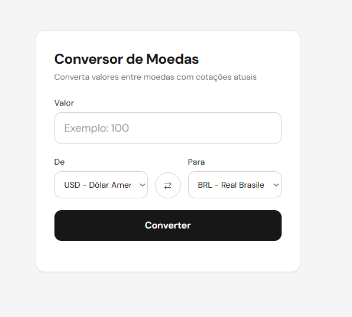
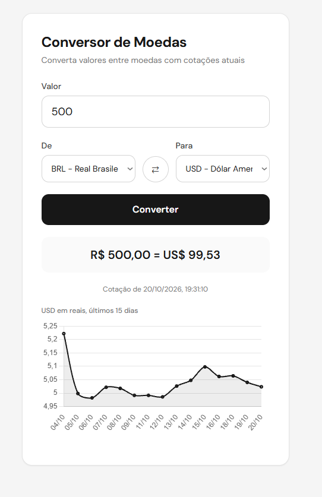

# Projeto Conversor de Moedas

Aplicação web que converte entre 6 moedas com cotações em tempo real (AwesomeAPI) e exibe o histórico do par escolhido em gráfico. JavaScript (ES modules, async/await), Tailwind CSS e Chart.js, com validação, tratamento de erros e layout responsivo.

**Link para o projeto publicado:** https://brunorodrigues10.github.io/conversor-de-moedas/

  
  

## Funcionalidades
- **Conversão entre BRL, USD, EUR, GBP, BTC e CHF**
- **Cotações em tempo real consumidas de uma API pública**
- **Botão para inverter as moedas de origem e destino**
- **Gráfico com o histórico dos últimos 15 dias da cotação**
- **Exibição da data e hora da cotação utilizada**
- **Validação do valor digitado (campo vazio, zero, negativo e valores inválidos)**
- **Tratamento de erros com mensagens claras (sem internet, falha na API, cotação não encontrada)**
- **Indicador de carregamento, com o botão desativado durante a busca para evitar requisições repetidas**
- **Layout responsivo, pensado primeiro para o celular**

## Tecnologias

- **HTML5 semântico**
- **JavaScript (ES6+): fetch, async/await, Promise.all, manipulação do DOM**
- **Tailwind CSS**
- **Chart.js para o gráfico**
- **AwesomeAPI para as cotações**
